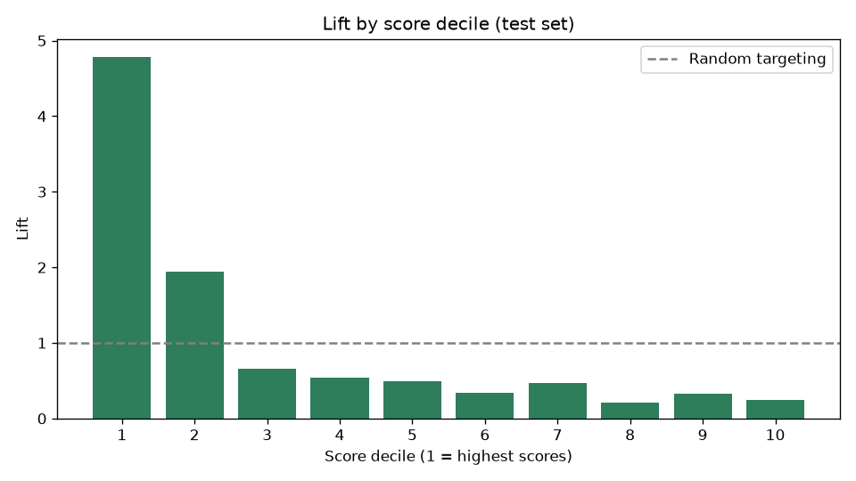
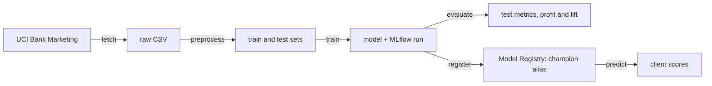

# Bank Term-Deposit Propensity Pipeline

End-to-end machine learning pipeline that ranks bank clients by their propensity to subscribe to a term deposit, so telemarketing campaigns call the right clients first.

Built as the FIAP Pós Tech (Machine Learning Engineering) Tech Challenge, Phase 2, with a focus on **ML engineering**: reproducible environment with Poetry, versioned data and pipeline with DVC, experiment tracking and Model Registry with MLflow, containerized execution with Docker, and clean, tested code.


## Business problem

A Portuguese retail bank runs telemarketing campaigns to sell term deposits. Only **11.3%** of contacted clients subscribe, so most calls are wasted cost and operator time. With an illustrative cost of €8 per call and a margin of €50 per deposit, a call only pays off when the subscription probability is above 16%, which means **calling every client loses money**.

The model scores each client before the campaign, so the bank calls the most promising clients first and skips those with very low propensity.

## Results

Champion model: **HistGradientBoosting** (`learning_rate=0.05`, 500 trees), evaluated on a held-out test set never used during training or model selection.

| Metric | Value | Reference |
|---|---|---|
| PR-AUC (test) | **0.497** | random targeting ≈ 0.113 |
| ROC-AUC (test) | **0.816** | random = 0.5 |
| Conversion in the top 10% scored clients | **53.9%** | base rate 11.3% (lift 4.8x) |
| Subscribers found in the top 20% scored clients | **67%** | 20% with random targeting |
| Campaign profit, calling everyone | **-€19,504** | illustrative costs |
| Campaign profit, calling the 17% chosen by the model | **+€18,866** | profit-maximizing threshold 0.53 |



Calling only the top 17% of clients ranked by the model finds 64% of all subscribers and turns a campaign loss into a profit. Costs and margins are illustrative assumptions defined in `params.yaml`.

## Architecture



| Step | Module | Orchestration |
|---|---|---|
| fetch | `data/fetch.py`: downloads the UCI archive and extracts the CSV | DVC stage |
| preprocess | `data/preprocess.py`: drops leakage, encodes target, adds contact flag, stratified split | DVC stage |
| train | `models/train.py`: cross-validation, final fit and MLflow logging | DVC stage |
| evaluate | `models/evaluate.py`: test metrics, profit-based threshold and lift by decile | DVC stage |
| register | `models/registry.py`: registers the trained model and moves the `@champion` alias | manual release step |
| predict | `models/predict.py`: loads `models:/bank-propensity-classifier@champion` and scores clients | application |

## Tech stack

| Area | Tools |
|---|---|
| Language | Python 3.11 |
| Dependencies | Poetry (separate `main` and `dev` groups, committed `poetry.lock`) |
| Modeling | Scikit-Learn (Logistic Regression, Random Forest, HistGradientBoosting) |
| Data and pipeline versioning | DVC (`dvc.yaml`, `dvc.lock`, `params.yaml`) |
| Experiment tracking and registry | MLflow (SQLite backend, Model Registry with aliases) |
| Container | Docker (Poetry production install, non-root user) |
| Quality | Ruff (lint and format), Pytest, pytest-cov |

## Project structure

```
bank-propensity-pipeline/
├── src/bank_propensity_pipeline/
│   ├── config.py            # settings from .env and params from params.yaml
│   ├── logging_config.py    # centralized logging
│   ├── pipeline.py          # runs all steps in order (Docker entry point)
│   ├── data/                # fetch, schema (column names), preprocess
│   ├── features/            # feature lists and ColumnTransformer
│   └── models/              # train, tracking, evaluate, registry, predict
├── tests/                   # unit tests with synthetic data only
├── notebooks/01_eda.ipynb   # exploratory analysis and pipeline decisions
├── docs/                    # ML canvas, model selection, model card
├── reports/                 # lift table and chart (generated by DVC)
├── metrics/                 # cross-validation and test metrics (generated by DVC)
├── dvc.yaml / dvc.lock      # pipeline definition and versioned state
├── params.yaml              # seed, split, hyperparameters, business assumptions
├── Dockerfile / .dockerignore
└── pyproject.toml / poetry.lock
```

## Getting started

### Prerequisites

- Python 3.11
- [Poetry](https://python-poetry.org/) 2.x (recommended install: `pipx install poetry`)
- Git
- Docker Desktop (only for the container run)

### Installation

```bash
git clone https://github.com/brenocarvalhods/bank-propensity-pipeline.git
cd bank-propensity-pipeline
poetry config virtualenvs.in-project true
poetry install
```

### Configuration

Copy the environment template. The default values work locally without changes.

```bash
# Linux / macOS
cp .env.example .env

# Windows (PowerShell)
Copy-Item .env.example .env
```

| Variable | Default | Purpose |
|---|---|---|
| `MLFLOW_TRACKING_URI` | `sqlite:///mlflow.db` | MLflow backend store (required by the Model Registry) |
| `MLFLOW_EXPERIMENT_NAME` | `bank-propensity` | experiment that groups all runs |
| `MLFLOW_MODEL_NAME` | `bank-propensity-classifier` | registered model name |
| `LOG_LEVEL` | `INFO` | logging level |

### Data

**No manual download is needed.** The `fetch` stage downloads the official archive from the UCI Machine Learning Repository ([Bank Marketing, id 222](https://archive.ics.uci.edu/dataset/222/bank+marketing)) and saves `bank-additional-full.csv` to `data/raw/`. The source URL is defined in `params.yaml`, and the file hash is recorded in `dvc.lock`, so any change in the source data is detected.

## Running the pipeline

```bash
poetry run dvc repro          # fetch, preprocess, train and evaluate
poetry run dvc dag            # show the pipeline graph
poetry run dvc metrics show   # cross-validation and test metrics
```

DVC only reruns the stages whose code, data or parameters changed. To change a hyperparameter or a business assumption, edit `params.yaml` and run `dvc repro` again.

### Experiment tracking

```bash
poetry run mlflow ui --backend-store-uri sqlite:///mlflow.db
```

Open http://127.0.0.1:5000. Every training run logs all parameters, cross-validation metrics, test metrics, the fitted pipeline with its input signature, and the lift report.

### Model Registry and scoring

```bash
poetry run python -m bank_propensity_pipeline.models.registry   # register and promote to @champion
poetry run python -m bank_propensity_pipeline.models.predict    # score clients with the champion
```

Registration is a deliberate release step, outside the DVC pipeline, so a new training run never replaces the champion automatically. Applications load the model by alias (`models:/bank-propensity-classifier@champion`), so promoting or rolling back a model does not require code changes.

## Running with Docker

```bash
docker build -t bank-propensity-pipeline .
docker run --rm -v bank-propensity-mlflow:/app/mlruns bank-propensity-pipeline
```

The container runs the full sequence: fetch, preprocess, train, evaluate, register and score. MLflow runs and the registry are kept in the `bank-propensity-mlflow` volume. To browse them:

```bash
docker run --rm -p 5000:5000 -v bank-propensity-mlflow:/app/mlruns bank-propensity-pipeline \
  mlflow ui --host 0.0.0.0 --backend-store-uri sqlite:////app/mlruns/mlflow.db
```

## Tests and code quality

```bash
poetry run pytest --cov=bank_propensity_pipeline --cov-report=term-missing
poetry run ruff check .
poetry run ruff format --check .
```

Tests use only synthetic data and in-memory archives, so they run without network access and without any trained model on disk.

## Reproducibility

- **Environment:** `poetry.lock` pins every dependency, including transitive ones.
- **Data:** the raw file hash is recorded in `dvc.lock`, and the source URL lives in `params.yaml`.
- **Pipeline:** `dvc.lock` records the hash of every input, parameter and output of each stage.
- **Randomness:** a single `seed` in `params.yaml` controls the train/test split, cross-validation folds and models.
- **Experiments:** every training run is tracked in MLflow and linked to the Git commit.

## Key decisions

| Decision | Reason |
|---|---|
| Dropped `last_call_duration_sec` | Call duration is only known after the call, so it is data leakage. |
| Replaced `days_since_previous_contact = 999` with a binary flag | 999 is a sentinel for "never contacted" (96% of clients), not a number of days. |
| Kept `"unknown"` as a category | Clients with unknown default status convert at less than half the rate of those who answered "no". |
| PR-AUC as the main metric, stratified split | Only 11.3% of clients subscribe, so accuracy is misleading. |
| HistGradientBoosting as champion | Tied with Random Forest on PR-AUC, best ROC-AUC, smaller and faster model. See [model selection](docs/model_selection.md). |
| Profit-maximizing decision threshold | The best threshold depends on call cost and deposit margin, not on the default 0.5. |
| Explicit skops trusted types | MLflow serializes scikit-learn models with skops, a safe format; only the tree types produced by our own models are trusted. |

## Documentation

- [Exploratory data analysis](notebooks/01_eda.ipynb)
- [ML canvas](docs/ml_canvas.md)
- [Model selection](docs/model_selection.md)
- [Model card](docs/model_card.md): intended use, limitations and monitoring plan

## Limitations and next steps

- Data covers 2008 to 2010 in Portugal, including the financial crisis. Macroeconomic features make the model sensitive to economic drift.
- The decision threshold was chosen on the test set, so the profit estimate is slightly optimistic.
- Next steps: out-of-time validation, probability calibration, a remote DVC storage, CI with GitHub Actions and a cloud deployment of the scoring service.

## Author

Breno Carvalho · [GitHub](https://github.com/brenocarvalhods)

## License

[MIT](LICENSE)
